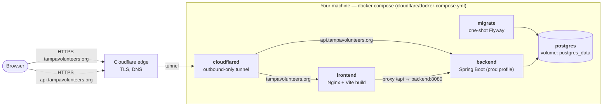

# Cloudflare Tunnel Dev Site

This guide covers running the Tampa Volunteers platform on your own machine with Docker
Compose and exposing it at `https://tampavolunteers.org` through a
[Cloudflare Tunnel](https://developers.cloudflare.com/cloudflare-one/connections/connect-networks/).
It is a **dev site**. It runs the same production builds as Fly.io, but its uptime is
your machine's uptime.

## Architecture



How it maps to the Fly.io setup (`../fly/README.md`):

| Fly.io | Cloudflare Tunnel stack |
|---|---|
| `tampavolunteers-frontend` app, `Dockerfile.prod` | `frontend` service, same Dockerfile, with `cloudflare/nginx.conf` mounted over the Fly one |
| `tampavolunteers-backend` app, `SPRING_PROFILES_ACTIVE=prod` | `backend` service, same image and profile |
| `[deploy] release_command` (Flyway) | `migrate` service, which runs once per `up` before `backend` starts |
| Fly Postgres | `postgres` service with a named volume |
| `*.fly.dev` public hostnames | `tampavolunteers.org` and `api.tampavolunteers.org` via `config.yml` |
| `fly secrets set` | `cloudflare/.env` (gitignored) |
| `fly/scripts/run-cli.sh` | `cloudflare/scripts/run-cli.sh` |

The tunnel only makes outbound connections, so you don't need port forwarding or a
static IP, and nothing listens on your LAN. The frontend (port 8081) and Postgres
(port 5434) are bound to `127.0.0.1` for local smoke tests and DB tools.

## Prerequisites

- Docker with the compose plugin
- [`cloudflared`](https://developers.cloudflare.com/cloudflare-one/connections/connect-networks/downloads/)
  (`brew install cloudflared`, or Cloudflare's apt/rpm repo at https://pkg.cloudflare.com)
- `openssl`
- A Cloudflare account (the free plan is fine)

## 1. Add tampavolunteers.org to Cloudflare (one-time)

1. In the [Cloudflare dashboard](https://dash.cloudflare.com), go to **Add a domain** and enter
   `tampavolunteers.org`. Choose the Free plan.
2. Cloudflare imports existing DNS records. **Delete any imported `A`/`AAAA`/`CNAME`
   records for `tampavolunteers.org` and `api`** (registrar parking pages, for example).
   The setup script creates tunnel CNAMEs for those names, and they will collide.
3. At your registrar, replace the nameservers with the two Cloudflare assigns.
4. Wait for the zone to show **Active**. This usually takes minutes but can take
   up to 24h.
5. Recommended: under **SSL/TLS → Edge Certificates**, enable **Always Use HTTPS**.

## 2. Run the setup script

```bash
cd cloudflare
./setup-tunnel.sh
```

The script will:
1. Verify prerequisites
2. Create `cloudflare/.env` from `.env.example` and generate `POSTGRES_PASSWORD` and `JWT_SECRET`
3. Run `cloudflared tunnel login` if needed (opens a browser; pick the `tampavolunteers.org` zone)
4. Create the `tampavolunteers-dev` tunnel, or reuse it if it exists, then write its
   credentials to `cloudflare/.cloudflared/credentials.json` (gitignored)
5. Create proxied DNS CNAMEs for `tampavolunteers.org` and `api.tampavolunteers.org`
   pointing at the tunnel
6. Build and start the stack, then show status

Each step can also be run on its own. See `./setup-tunnel.sh --help`.

## 3. Configure OAuth2 (optional)

Without these, email/password login still works. Edit `cloudflare/.env`, then run
`./setup-tunnel.sh --up`.

#### Google OAuth2

1. [Google Cloud Console](https://console.cloud.google.com/apis/credentials) > Create Credentials > OAuth client ID
2. Authorized JavaScript origins: `https://tampavolunteers.org`
3. Authorized redirect URIs:
   ```
   https://tampavolunteers.org/api/login/oauth2/code/google
   https://api.tampavolunteers.org/api/login/oauth2/code/google
   ```

#### GitHub OAuth2

1. [GitHub Developer Settings](https://github.com/settings/developers) > OAuth Apps > New OAuth App
2. Homepage URL: `https://tampavolunteers.org`
3. Authorization callback URL: `https://tampavolunteers.org/api/login/oauth2/code/github`

The login buttons go through the same-origin `/api` proxy, so the `tampavolunteers.org`
callbacks are the ones in use. The `api.` Google URI covers OAuth flows started directly
against the API hostname.

## Day-to-day

| Command | Purpose |
|---|---|
| `./setup-tunnel.sh --up` | Rebuild from the current checkout and restart (the "deploy") |
| `./setup-tunnel.sh --down` | Stop everything (the database volume is kept) |
| `./setup-tunnel.sh --status` | Container health, tunnel connections, URLs |
| `./setup-tunnel.sh --logs [service]` | Tail logs, e.g. `--logs backend` |
| `curl -s http://127.0.0.1:8081/api/actuator/health` | Local smoke test, bypassing Cloudflare |

The stack uses its own compose project (`tampavolunteers-tunnel`) and ports, so it can run
alongside the root `docker-compose.yml` hot-reload dev stack.

### Database Admin CLI

```bash
./scripts/run-cli.sh list-users --all
./scripts/run-cli.sh add-super-admin you@example.com
./scripts/run-cli.sh seed-volunteers 25
```

These are the same AdminCLI commands as `fly/scripts/` (see `../fly/README.md`).

### Connecting a DB tool

Postgres listens on `127.0.0.1:5434`. The user is `tampavolunteers` and the password is
`POSTGRES_PASSWORD` in `cloudflare/.env`.

## Restricting access (recommended for a dev site)

Anyone can reach the site by default. To limit it to specific people, add a
[Cloudflare Access](https://developers.cloudflare.com/cloudflare-one/applications/configure-apps/self-hosted-apps/)
self-hosted application for `tampavolunteers.org` and `api.tampavolunteers.org`, with a
policy such as "emails ending in …" or a list of addresses. Zero Trust is free for up
to 50 users. Access sits in front of the tunnel, so the app config doesn't change.

## Security notes

- `cloudflare/.env` and `cloudflare/.cloudflared/` contain secrets and are gitignored.
  The tunnel credentials file lets anyone run your tunnel. If it leaks, rotate it with
  `cloudflared tunnel delete tampavolunteers-dev` and re-run setup.
- The backend trusts `X-Forwarded-*` headers from Docker private address ranges
  (`SERVER_TOMCAT_REMOTEIP_INTERNALPROXIES` in `docker-compose.yml`). This is safe
  because the backend publishes no host port, so only `frontend` and `cloudflared` can
  reach it.

## Troubleshooting

### `502 Bad Gateway` / Cloudflare error 1033
- 1033 means the tunnel isn't connected. Check that `cloudflared` is running:
  `./setup-tunnel.sh --logs cloudflared`.
- A 502 from Nginx usually means the backend is still starting (allow about 60s) or
  `migrate` failed. Run `./setup-tunnel.sh --logs migrate backend`.

### `backend` never starts
It waits for `migrate` to exit successfully. Check `docker compose ps -a` and the
`migrate` logs for Flyway errors.

### DNS route fails with "record already exists"
Delete the conflicting record in the Cloudflare dashboard, then run
`./setup-tunnel.sh --dns`.

### OAuth redirect goes to `http://` or the wrong host
Check that requests come through the tunnel (cloudflared sets `X-Forwarded-Proto: https`)
and that the redirect URIs above are registered exactly.

## Changing hostnames

The hostnames appear in three places: `config.yml` (ingress rules), `SITE_HOSTNAME`/`API_HOSTNAME` in
`.env` (DNS routing, CORS, OAuth success redirect), and the OAuth provider consoles.
After changing them, run `./setup-tunnel.sh --dns` and then `--up`.

## Cleanup

```bash
./setup-tunnel.sh --down
docker volume rm tampavolunteers-tunnel_postgres_data   # deletes the database
cloudflared tunnel delete tampavolunteers-dev
# then delete the two CNAME records in the Cloudflare dashboard
```

## File Structure

```
cloudflare/
├── README.md            # This file
├── docker-compose.yml   # postgres, migrate, backend, frontend, cloudflared, cli
├── config.yml           # cloudflared ingress rules (hostname -> service)
├── nginx.conf           # Frontend Nginx config for the compose network
├── .env.example         # Template for cloudflare/.env
├── setup-tunnel.sh      # Setup + day-to-day operations
└── scripts/
    └── run-cli.sh       # Run AdminCLI commands against the stack's database
```
